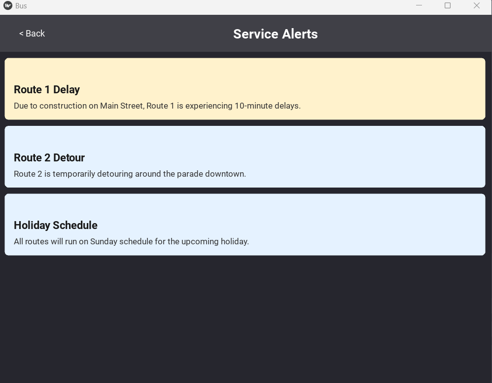
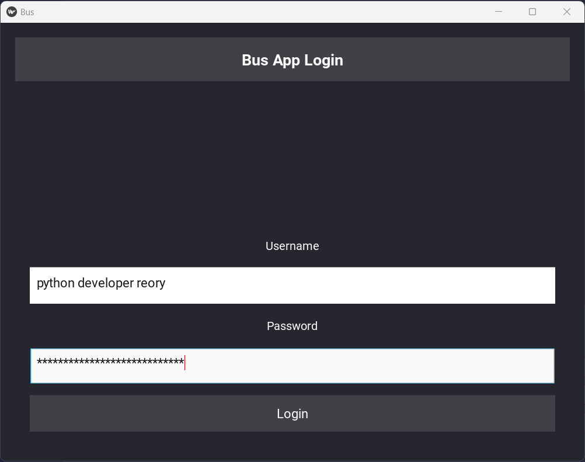
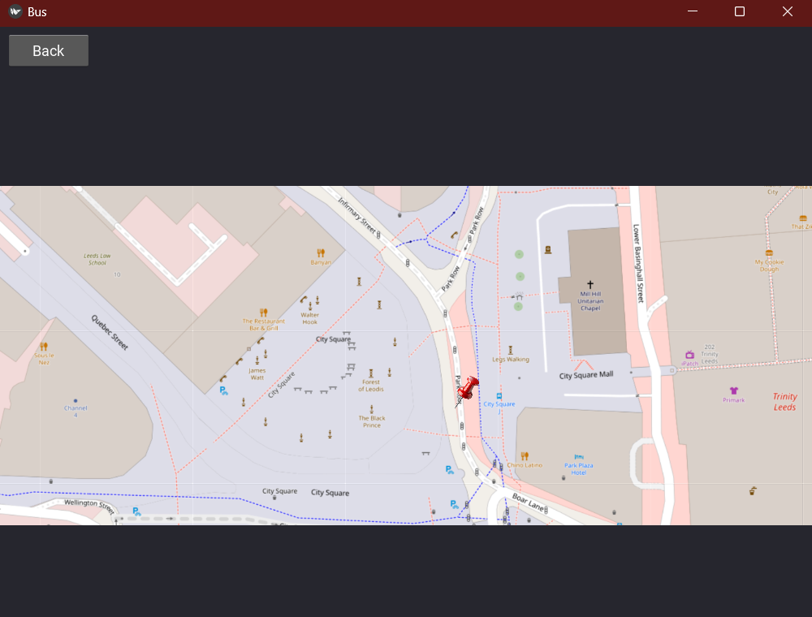
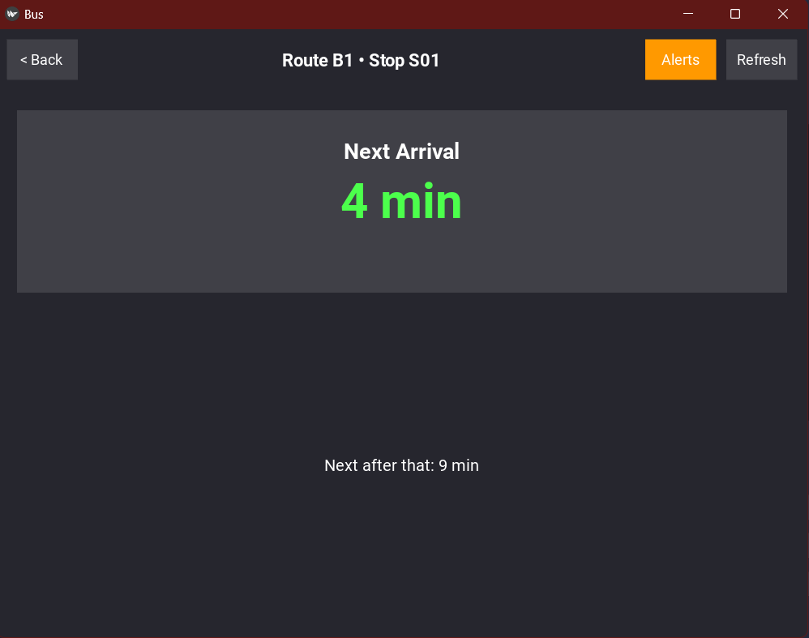
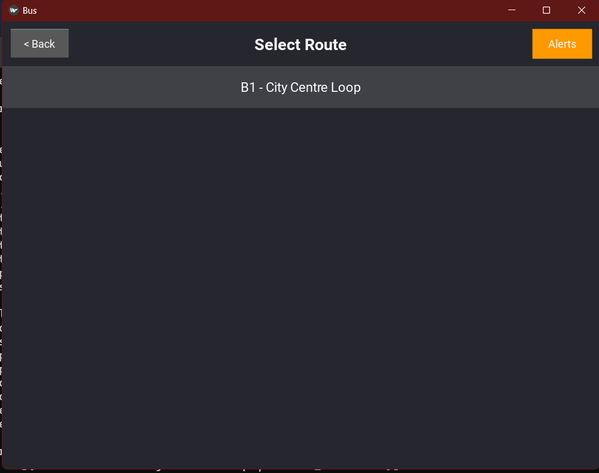
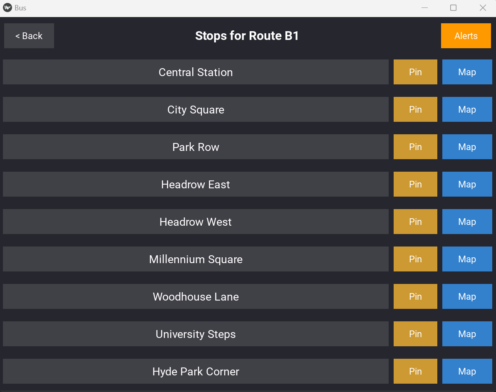
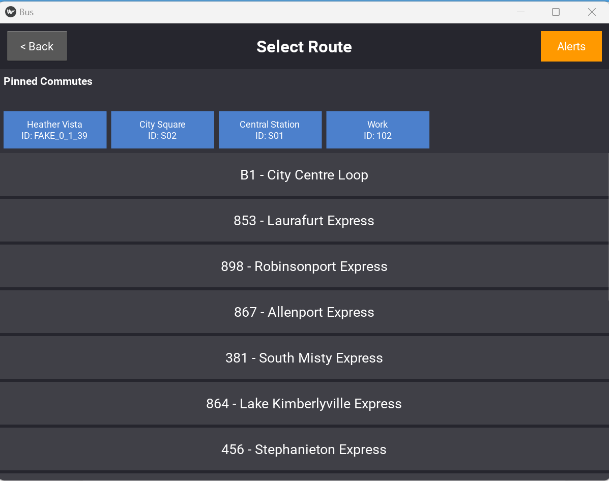

# 🚍 Bus App


A full-stack transit app featuring a  Django REST framework and a Multi-threaded Kivy mobile interface.

A Reliable transit apps require robust front-end logic. I built this UK Bus App (v3) as a Proof of Concept to demonstrate a mobile-ready UI (Kivy) capable of processing transit data. To ensure a consistent demo experience without API rate-limiting, v3 utilizes a mocked data engine that simulates real-world bus arrivals.

---

<details>
  <summary>📱 App Gallery</summary>

<p align="center">
  
  
  
  
  
  
  
</p>

</details>

---

## 🚀 Features

* **30/30 Passing Unit Tests**✅
* **⭐ Personalised Pinned Commutes** - Instantly view favourite stops on the Kivy dashboard that a user of the app can pin.
* **Mocked Time** - (Proof of concept)
* **Multi-threaded Kivy UI**
* **Django REST Framework Backend** (Scalable app structure)

---

## 📦 Installation

**Clone the repository and install:**
```bash
git clone https://github.com/reory/bus_app.git
cd bus_app
pip install -r requirements.txt
python manage.py migrate
```

### Database Initialization & Data Pipeline

Since SQLite database files (db.sqlite3) are ignored in Git, you need to migrate the database and populate it using the following step-by-step pipeline:

- **Step A: Run Database Migrations**
Creates all necessary tables for Django, GTFS models, and API models.
```bash
python manage.py migrate
```

- **Step B: Import Base GTFS Sample Data**
Imports base GTFS anchors (coordinates, agency info, existing stop locations) from gtfs_sample.zip.
```bash
python manage.py import_gtfs
```

- **Step C: Seed Synthetic/Fake Stops and Routes**
Uses the Faker library to generate multi-stop routes anchored near real GTFS points. You can change --count to generate more or fewer routes.
```bash
python manage.py seed_fake_stops --count 10
```

- **Step D: Sync GTFS & Seeded Data to API Layer**
Projects all GTFS data and seeded synthetic routes into the API endpoints consumed by the Kivy mobile/desktop frontend.
```bash
python manage.py sync_gtfs_to_api
```

**Quick Setup Summary (TL;DR)**
If you just cloned the repository or wiped db.sqlite3, execute this command chain:
python manage.py migrate && python manage.py import_gtfs && python manage.py seed_fake_stops

---

## Usage

This project requires both the backend and frontend to be running simultaneously.

1. **Start the backend:** 
   ```bash
    python manage.py runserver 
    ```

2. **Start the frontend:**
  cd frontend
   ```bash
   python main.py
   ```

---

## 📁 Project Structure

```text
bus_app/
├── api/                  # Main API Gateway & GTFS Imports
├── bus_backend/          # Project Core
│   ├── apps/             # Modular Business Logic
│   │   ├── notifications/# User alerts & notifications
│   │   ├── realtime/     # Live bus tracking data
│   │   ├── routes/       # GTFS route & stop management
│   │   └── users/        # Custom user models & auth
│   └── settings.py       # Global configuration
├── frontend/             # Kivy Mobile Application
├── tests/                # 30 Unit tests (Backend & Frontend)
├── manage.py             # Django management script
└── main.py               # Kivy entry point
```

---

## Testing🚦

The project includes a comprehensive suite of 17 tests covering models, serializers, and the Kivy UI logic.

To run the tests:
```bash
pytest
```

---

## 🧑🏽‍💻 Technologies Used

- Python 3.x
- Faker
- Django (REST framework)
- Kivy (UI Framework)
- Pytest (Testing)

---

## 🛣️ Roadmap Features

- [x] Synthetic GTFS Generator (Faker)
The Goal: Build a localized data factory to simulate a bustling city transit network.
The Tech: Use `faker`.providers.address to generate realistic street name bus stops (e.g., "Main St & 4th Ave") and clamp random lat/long coordinates within a tight boundary to simulate a dense downtown core.

- [x] Personalized Dashboards
The Goal: Let users see their daily commute countdown immediately.
The Tech: Build a "Favourites" schema allowing users to pin specific stop IDs directly to the launch screen, skipping the route menus entirely.

- [ ] Offline Spatial Caching
The Goal: Keep the app functional when cellular data drops out.
The Tech: Embed a lightweight `SQLite` cache on the `Kivy` client to store and render route shapes and stop layouts completely offline.

- [ ] Geospatial Proximity & Geofencing Engine
The Goal: Enable intelligent location-based triggers, such as detecting when a user is within walking distance of a stop or calculating precise route lengths.
The Tech: Use `pyproj` for accurate geodesic distance calculations in meters, and `shapely` to build buffer zones (polygons) around stops to handle proximity intersections and geofencing checks.

- [ ] WebSocket Push Alerts
The Goal: Notify riders of sudden route delays instantly.
The Tech: Use `Django` Channels to maintain live WebSocket connections, pushing urgent service disruptions directly to the `Kivy` UI.

- [ ] Multi-Stop Journey Planner
The Goal: Give the app actual point-A to point-B routing capabilities.
The Tech: Implement pathfinding algorithms (like Dijkstra’s or Connection Scan) on the backend to calculate the fastest multi-stop trips.

- [ ] Rust-Powered Schedule Matrix Compiler
The Goal: Generate millions of realistic, connected schedule times without melting your CPU.
The Tech: Pass your synthetic `faker` stop lists into a `Rust` + `PyO3` extension. Let `Rust` handle the heavy loop calculations to instantly generate sequential arrival and departure times (StopTime rows) for thousands of simulated trips.

---

## Notes
- Version 1.3 release. 
- 30 passing unit tests.
- Ensure the Django backend is running before starting the Kivy frontend.

**Built By Roy Peters** [Click here for contact details 😁](https://www.linkedin.com/in/roy-p-74980b382/)